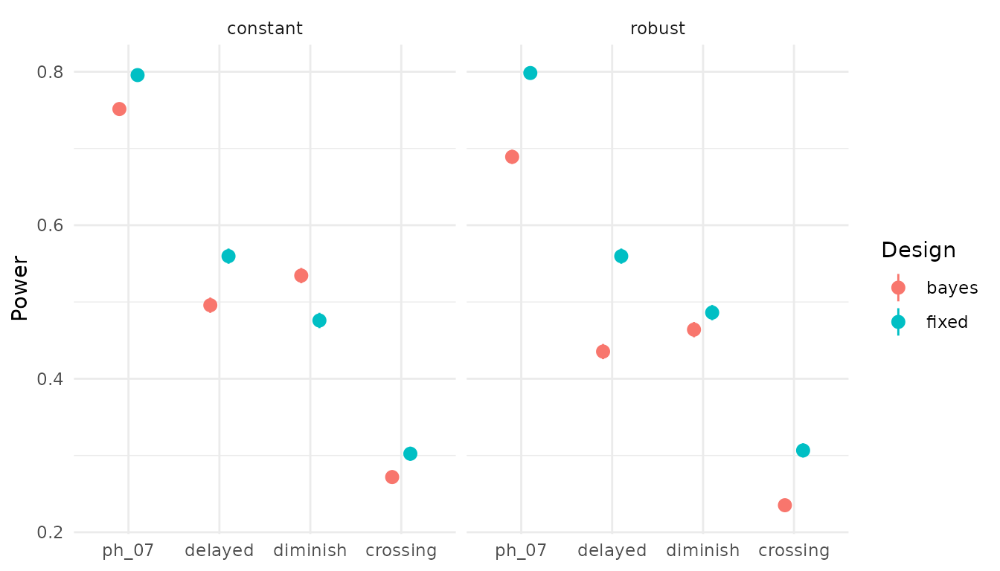
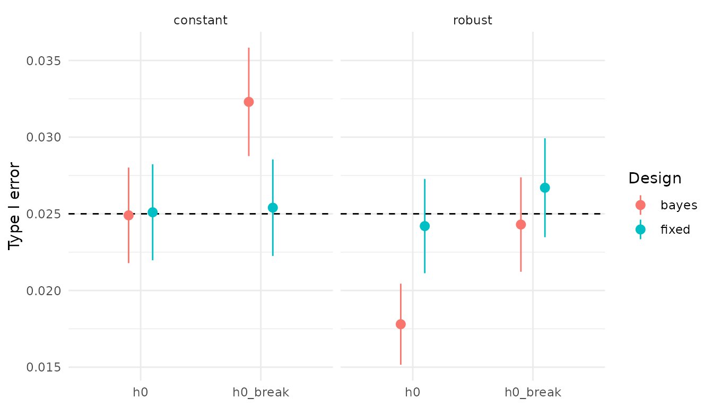

# Fixed versus Bayesian adaptive designs for two-arm survival trials

``` r

library(adaptsurv)
```

## 1 Motivation

Oncology trials require a large number of patients to reach a conclusion
with acceptable error rates. However, if the data in the beginning of
the trial are already conclusive in either direction, one can stop early
for efficacy or futility. This faster decision saves time and money and
exposes fewer patients to an inferior treatment. However, the decision
thresholds have to be adjusted for the repeated looks, and this can cost
power. This vignette examines how a Bayesian adaptive design compares
with a fixed log-rank design in type I error, power, expected events and
duration, and how robust it is when hazards are not proportional.

## 2 Simulation setup

We simulate trials with 400 patients each, recruited uniformly over 24
months, randomised 1:1, with exponential drop-out at a rate of 0.005 per
month. Event times follow a piecewise exponential distribution, i.e. the
hazard is piecewise constant;
[`rpwexp()`](https://adrianwurm.github.io/adaptsurv/reference/rpwexp.md)
draws them by inverting the cumulative hazard. Each analysis uses the
data available at the calendar time of the k-th observed event
([`cut_at_events()`](https://adrianwurm.github.io/adaptsurv/reference/cut_at_events.md)).
The latent data of a trial are simulated once, and all analyses of that
trial are data cuts of it. Interim and final analyses therefore use the
*same* trial, as in practice.

One simulated trial under HR = 0.7, cut at the first interim analysis:

``` r

set.seed(1)
lambda_c <- log(2) / 12                       # control median 12 months
trial <- simulate_trial(n = 400, accrual_time = 24,
                        rates_c = lambda_c, rates_t = 0.7 * lambda_c,
                        dropout_rate = 0.005)
head(trial)
#>   id arm      entry event_time dropout_time
#> 1  1   1 0.03155176 17.1710102   115.505356
#> 2  2   0 0.11439469 13.0759079    12.388053
#> 3  3   0 0.22972300  1.0667446   634.197117
#> 4  4   1 0.23569169  0.0476717     5.973495
#> 5  5   1 0.27216463  8.3892983   662.289441
#> 6  6   0 0.28223363  6.4007498   501.315917

cut <- cut_at_events(trial, n_events = 124)
cut$t_cut                                     # calendar time of the cut
#> [1] 22.76588
head(cut$data)
#>   id arm       time status
#> 1  1   1 17.1710102      1
#> 2  2   0 12.3880534      0
#> 3  3   0  1.0667446      1
#> 4  4   1  0.0476717      1
#> 5  5   1  8.3892983      1
#> 6  6   0  6.4007498      1
```

## 3 The two designs

### Fixed design

Schoenfeld’s formula gives the number of events required for HR = 0.7, a
one-sided type I error of 2.5 % and 80 % power:
`D = 4 (z_0.975 + z_0.8)^2 / log(0.7)^2`, which rounds up to 247. The
signed log-rank statistic for the treatment arm is
`z = (O - E) / sqrt(V)`; we reject if `z < qnorm(0.025)` and use the Cox
hazard ratio as the effect estimate.

``` r

analyse_fixed(cut$data)
#>            z  p_one_sided           hr 
#> -2.980246307  0.001440083  0.585602859
run_fixed(trial, n_events = 247)
#>      reject          hr       t_cut n_recruited    n_events 
#>     1.00000     0.58614    36.43408   400.00000   247.00000
```

### Bayesian adaptive design

We use an exponential working model with a Gamma(a0, b0) prior per arm,
a0 = 1 and b0 = 12 / log(2). This prior carries the information of a
single event, centred on the control median, and is negligible compared
with the 124 or more observed events. The conjugate posterior is
Gamma(a0 + d, b0 + T) per arm, with d the number of events and T the
total exposure time in that arm. The decision quantity is the posterior
probability P(HR \< 1 \| data); since HR = lambda_t / lambda_c, it has
the closed form `pbeta(b_t / (b_t + b_c), a_t, a_c)`, where (a_t, b_t)
and (a_c, b_c) are the posterior parameters of the two arms. We analyse
at 124, 185 and 247 events (50 / 75 / 100 % of D), stop for efficacy if
P(HR \< 1 \| data) \> c at any analysis, and stop for futility at the
interim analyses if P(HR \< 1 \| data) \< 0.2 (non-binding). With a weak
prior, P(HR \< 1 \| data) is close to 1 minus the one-sided log-rank
p-value, as the numbers below show.

``` r

analyse_bayes(cut$data, a0 = 1, b0 = 12 / log(2))
#>      prob hr_median 
#> 0.9986005 0.5856206
1 - analyse_fixed(cut$data)[["p_one_sided"]]
#> [1] 0.9985599

run_bayes_adaptive(trial, c_eff = 0.9918, a0 = 1, b0 = 12 / log(2))
#>        reject     stop_look stop_futility            hr      n_events 
#>     1.0000000     1.0000000     0.0000000     0.5856029   124.0000000 
#>         t_cut   n_recruited 
#>    22.7658790   379.0000000
```

## 4 Calibration of the efficacy threshold

With a single analysis, c = 0.975 = 1 - 0.025 would essentially
reproduce the log-rank test. With three analyses and c = 0.975, the
simulated type I error is 4.8 % (normal approximation: 4.9 %). Without
futility, the design rejects if and only if `max_k P_k > c`, so c is the
97.5 % quantile of `max_k P_k` under H0
([`calibrate_bayes()`](https://adrianwurm.github.io/adaptsurv/reference/calibrate_bayes.md)).
Calibration under constant hazards returns c = 0.9873 (theory: 0.9877).
On 10,000 independent trials, the type I error is 2.37 % (Monte Carlo SE
0.16 percentage points). The threshold lies between 0.975 (one look) and
the Šidák bound for independent looks, 0.9916, because every analysis
contains the data of all earlier analyses, so the posterior
probabilities at the three looks are positively correlated.

The calibration was run once (it takes a few minutes) with:

``` r

set.seed(2026)
calibrate_bayes(n_sim = 10000, a0 = 1, b0 = 12 / log(2),
                n = 400, accrual_time = 24,
                rates_c = lambda_c, rates_t = lambda_c,
                dropout_rate = 0.005)
#> 0.9873009
```

## 5 Operating characteristics

All scenarios use the control hazard λ = log(2)/12 (median survival 12
months) and, where the hazard changes, a single change point at 6
months:

| Scenario | Control arm | Treatment arm, months 0–6 | Treatment arm after 6 months | Hazard ratio over time |
|----|----|----|----|----|
| `h0` | λ | λ | λ | 1 |
| `h0_break` | λ, then 0.6 λ | λ | 0.6 λ | 1 |
| `ph_07` | λ | 0.7 λ | 0.7 λ | 0.7 |
| `delayed` | λ | λ | 0.6 λ | 1 → 0.6 |
| `diminish` | λ | 0.5 λ | λ | 0.5 → 1 |
| `crossing` | λ | 1.3 λ | 0.5 λ | 1.3 → 0.5 |

The results below are precomputed with
[`operating_characteristics()`](https://adrianwurm.github.io/adaptsurv/reference/operating_characteristics.md)
(10,000 trials per scenario, see
[`?oc_results`](https://adrianwurm.github.io/adaptsurv/reference/oc_results.md)
and `dev/run_oc.R`). A small run looks like this:

``` r

scenarios <- list(
  h0    = list(rates_c = lambda_c, breaks_c = numeric(0),
               rates_t = lambda_c, breaks_t = numeric(0)),
  ph_07 = list(rates_c = lambda_c, breaks_c = numeric(0),
               rates_t = 0.7 * lambda_c, breaks_t = numeric(0))
)
set.seed(3)
operating_characteristics(scenarios, n_sim = 50, c_eff = 0.9873,
                          a0 = 1, b0 = 12 / log(2))
#>   scenario design reject  reject_se        hr n_events duration n_recruited
#> 1       h0  fixed   0.00 0.00000000 1.0036375   247.00 31.08329      400.00
#> 2       h0  bayes   0.02 0.01979899 1.0291276   216.22 27.97236      382.58
#> 3    ph_07  fixed   0.86 0.04907138 0.6894366   247.00 34.97289      400.00
#> 4    ph_07  bayes   0.84 0.05184593 0.6639330   185.40 27.65699      377.44
#>   early_stop stop_futility
#> 1       0.00            NA
#> 2       0.28          0.26
#> 3       0.00            NA
#> 4       0.60          0.00
```

``` r

oc <- oc_results
oc$scenario <- factor(oc$scenario,
                      levels = c("h0", "h0_break", "ph_07",
                                 "delayed", "diminish", "crossing"))
oc_null <- oc[oc$scenario %in% c("h0", "h0_break"), ]
oc_alt  <- oc[!oc$scenario %in% c("h0", "h0_break"), ]
```

### Proportional hazards (HR = 0.7)

``` r

ph <- oc[oc$scenario == "ph_07",
         c("calibration", "design", "reject", "hr", "n_events",
           "duration", "n_recruited", "early_stop")]
knitr::kable(ph, digits = 3, row.names = FALSE,
             col.names = c("Calibration", "Design", "Power", "HR (geom. mean)",
                           "Events", "Duration (months)", "Recruited", "Early stop"))
```

| Calibration | Design | Power | HR (geom. mean) | Events | Duration (months) | Recruited | Early stop |
|:---|:---|---:|---:|---:|---:|---:|---:|
| constant | fixed | 0.796 | 0.700 | 247.000 | 34.679 | 400.000 | 0.000 |
| constant | bayes | 0.751 | 0.675 | 185.636 | 27.408 | 378.746 | 0.608 |
| robust | fixed | 0.798 | 0.700 | 247.000 | 34.699 | 400.000 | 0.000 |
| robust | bayes | 0.689 | 0.675 | 193.121 | 28.310 | 382.016 | 0.540 |

*Early stop* is the proportion of trials that stopped at an interim
analysis, for efficacy or futility.

With the constant calibration, the Bayesian design needs about a quarter
fewer events and finishes about 7 months earlier, at the cost of about 5
percentage points of power. The geometric mean of the hazard ratio
estimates is 0.700 for the fixed design (unbiased) and 0.675 for the
adaptive design: trials that stop early tend to do so when the estimate
is, by chance, particularly favourable.

### Non-proportional hazards

``` r

library(ggplot2)
ggplot(oc_alt, aes(x = scenario, y = reject, colour = design)) +
  geom_pointrange(aes(ymin = reject - 2 * reject_se,
                      ymax = reject + 2 * reject_se),
                  position = position_dodge(width = 0.4)) +
  facet_wrap(~ calibration) +
  labs(x = NULL, y = "Power", colour = "Design") +
  theme_minimal()
```



Early analyses help when the effect is strongest early (`diminish`: with
the constant calibration, the adaptive design has more power than the
fixed design) and hurt when it is weakest early (`delayed`, `crossing`).
The futility rule stops about 4 % of trials with a delayed (but real)
effect and about 22 % under crossing hazards. Under crossing hazards,
early harm and later benefit partly cancel, and both designs have low
power.

### Type I error and robustness of the calibration

``` r

ggplot(oc_null, aes(x = scenario, y = reject, colour = design)) +
  geom_hline(yintercept = 0.025, linetype = "dashed") +
  geom_pointrange(aes(ymin = reject - 2 * reject_se,
                      ymax = reject + 2 * reject_se),
                  position = position_dodge(width = 0.4)) +
  facet_wrap(~ calibration) +
  labs(x = NULL, y = "Type I error", colour = "Design") +
  theme_minimal()
```



The log-rank test, being nonparametric, keeps its level of 2.5 % in both
null scenarios. If the Bayesian design is calibrated under constant
hazards, its type I error rises to 3.2 % when both arms share a hazard
with a change point. The exponential working model is then misspecified,
and its posterior is too concentrated. Calibrating additionally under
`h0_break` gives c = 0.9918, which is even above the Šidák bound of
0.9916. This robust threshold keeps 2.4 % under `h0_break`, is
conservative (1.8 %) under constant hazards and costs about 6 percentage
points of power under proportional hazards. The conclusion is that a
simulation-based calibration is only valid under the assumptions it was
done under.

### Efficiency

``` r

eff <- oc_alt[oc_alt$design == "bayes",
              c("calibration", "scenario", "n_events", "duration",
                "n_recruited", "early_stop", "stop_futility")]
knitr::kable(eff, digits = 3, row.names = FALSE,
             col.names = c("Calibration", "Scenario", "Events", "Duration (months)",
                           "Recruited", "Early stop", "Futility stop"))
```

| Calibration | Scenario | Events | Duration (months) | Recruited | Early stop | Futility stop |
|:---|:---|---:|---:|---:|---:|---:|
| constant | ph_07 | 185.636 | 27.408 | 378.746 | 0.608 | 0.002 |
| constant | delayed | 220.972 | 31.094 | 390.765 | 0.280 | 0.043 |
| constant | diminish | 192.060 | 27.319 | 377.731 | 0.504 | 0.002 |
| constant | crossing | 216.320 | 30.247 | 382.672 | 0.278 | 0.221 |
| robust | ph_07 | 193.121 | 28.310 | 382.016 | 0.540 | 0.002 |
| robust | delayed | 225.267 | 31.599 | 392.352 | 0.236 | 0.043 |
| robust | diminish | 200.345 | 28.160 | 381.501 | 0.435 | 0.003 |
| robust | crossing | 216.571 | 30.298 | 382.410 | 0.271 | 0.228 |

*Early stop* is the proportion of trials that stopped at an interim
analysis, for efficacy or futility; *Futility stop* is the proportion
stopped for futility.

## 6 Limitations

- Exponential working model with a single Gamma prior; a piecewise
  exponential model would be more robust.
- The robust calibration only protects against the null shapes it
  includes.
- 1:1 randomisation, uniform accrual, interim analyses at exact event
  counts.
- Crossing hazards: is the hazard ratio the right estimand? (e.g. the
  restricted mean survival time, RMST)
- Same maximum number of events for both designs; power could be
  recovered by a larger maximum or an O’Brien-Fleming-like threshold
  schedule.
- Each scenario has a single abrupt change of the hazard ratio, whereas
  effects typically develop gradually. Smoothly changing hazards,
  e.g. Weibull distributions, were not considered; they would show how
  the exponential working model behaves under gradual rather than abrupt
  misspecification.
  [`rpwexp()`](https://adrianwurm.github.io/adaptsurv/reference/rpwexp.md)
  can, however, approximate such hazards with many change points.

## 7 Reproducibility

The precomputed results were generated by the scripts `dev/calibrate.R`
(calibration; seeds 2026 and 2032, validation 2027) and `dev/run_oc.R`
(operating characteristics; seeds 2031 and 2033) in the GitHub
repository; the `dev/` folder is not part of the installed package. Each
script runs for up to about 15 minutes. The package was developed with
Claude (Anthropic) as a tutor and coding assistant: package scaffolding,
code templates, the vignette skeleton and code reviews were AI-assisted;
the implementation of the statistical core, the simulations and their
interpretation are my own.

``` r

sessionInfo()
#> R version 4.6.2 (2026-10-29)
#> Platform: x86_64-pc-linux-gnu
#> Running under: Ubuntu 24.04.5 LTS
#> 
#> Matrix products: default
#> BLAS:   /usr/lib/x86_64-linux-gnu/openblas-pthread/libblas.so.3 
#> LAPACK: /usr/lib/x86_64-linux-gnu/openblas-pthread/libopenblasp-r0.3.26.so;  LAPACK version 3.12.0
#> 
#> locale:
#>  [1] LC_CTYPE=C.UTF-8       LC_NUMERIC=C           LC_TIME=C.UTF-8       
#>  [4] LC_COLLATE=C.UTF-8     LC_MONETARY=C.UTF-8    LC_MESSAGES=C.UTF-8   
#>  [7] LC_PAPER=C.UTF-8       LC_NAME=C              LC_ADDRESS=C          
#> [10] LC_TELEPHONE=C         LC_MEASUREMENT=C.UTF-8 LC_IDENTIFICATION=C   
#> 
#> time zone: UTC
#> tzcode source: system (glibc)
#> 
#> attached base packages:
#> [1] stats     graphics  grDevices utils     datasets  methods   base     
#> 
#> other attached packages:
#> [1] ggplot2_4.0.3   adaptsurv_0.1.0
#> 
#> loaded via a namespace (and not attached):
#>  [1] vctrs_0.7.3        cli_3.6.6          knitr_1.52         rlang_1.3.0       
#>  [5] xfun_0.62          otel_0.2.0         S7_0.2.2           textshaping_1.0.5 
#>  [9] jsonlite_2.0.0     labeling_0.4.3     glue_1.8.1         htmltools_0.5.9   
#> [13] ragg_1.5.2         sass_0.4.10        scales_1.4.0       rmarkdown_2.32    
#> [17] grid_4.6.2         evaluate_1.0.5     jquerylib_0.1.4    fastmap_1.2.0     
#> [21] yaml_2.3.12        lifecycle_1.0.5    compiler_4.6.2     RColorBrewer_1.1-3
#> [25] fs_2.1.0           lattice_0.23-1     farver_2.1.2       systemfonts_1.3.2 
#> [29] digest_0.6.39      R6_2.6.1           splines_4.6.2      Matrix_1.7-6      
#> [33] bslib_0.12.0       withr_3.0.3        tools_4.6.2        gtable_0.3.6      
#> [37] survival_3.8-12    pkgdown_2.2.1      cachem_1.1.0       desc_1.4.3
```
